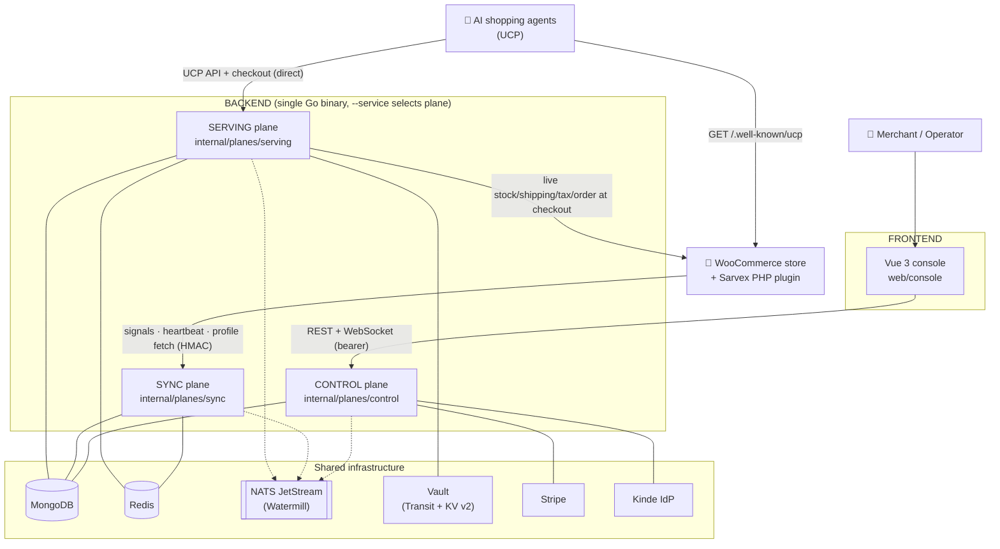

# Sarvex V1 — Architecture (Backend & Frontend)

> **In one sentence:** Sarvex makes a WooCommerce or Magento merchant's products transactable by AI shopping agents over the Universal Commerce Protocol (UCP) — Sarvex hosts the merchant's UCP profile and checkout endpoints, keeps their data agent-ready, and monitors the integration so it never silently breaks.
>
> **Scope authority:** this document describes the architecture **as currently implemented** in this repository. It is organised into a **Backend Architecture** part (the Go services, plugin, and shared packages) and a **Frontend Architecture** part (the Vue console), followed by **Risks** and **Dependencies** sections. It documents only what exists. Where the code and this document disagree, the code wins and this document is the bug.

*Status: implementation-derived architecture · regenerated from the current tree · supersedes prior design-session drafts*

---

## Table of contents

- [Part 0 — System overview](#part-0--system-overview)
- [Part A — Backend architecture](#part-a--backend-architecture)
  - [A1. Process model & entrypoint](#a1-process-model--entrypoint)
  - [A2. The three planes](#a2-the-three-planes)
  - [A3. Serving plane](#a3-serving-plane)
  - [A4. Sync plane](#a4-sync-plane)
  - [A5. Control plane](#a5-control-plane)
  - [A6. Shared packages (`internal/pkg`)](#a6-shared-packages-internalpkg)
  - [A7. The WooCommerce plugin (PHP)](#a7-the-woocommerce-plugin-php)
  - [A8. Data stores](#a8-data-stores)
  - [A9. Event & command topics](#a9-event--command-topics)
  - [A10. Backend invariants](#a10-backend-invariants)
- [Part B — Frontend architecture](#part-b--frontend-architecture)
  - [B1. Stack & build](#b1-stack--build)
  - [B2. Routing & surfaces](#b2-routing--surfaces)
  - [B3. State: Pinia stores](#b3-state-pinia-stores)
  - [B4. API layer & type generation](#b4-api-layer--type-generation)
  - [B5. Authentication](#b5-authentication)
  - [B6. Component system](#b6-component-system)
- [Part C — Risks](#part-c--risks)
- [Part D — Dependencies](#part-d--dependencies)

---

## Part 0 — System overview

Sarvex V1 is a **single Go binary** that runs as one of three planes (`serving`, `sync`, `control`), a **PHP WooCommerce plugin** that runs on the merchant's own server, and a **Vue 3 web console** for merchants and operators. The planes are separated by availability, latency, and trust characteristics and communicate through a NATS JetStream event bus (Watermill), never by direct in-process cross-plane calls.

**Runtime technology (from `go.mod` / `package.json`):**

| Concern | Choice |
|---|---|
| Language / runtime | Go 1.26 (backend), TypeScript / Vue 3 (frontend), PHP (plugin) |
| HTTP framework | `labstack/echo/v4` |
| CLI / config | `spf13/cobra` + `spf13/viper`, `.env` via `joho/godotenv` |
| Primary datastore | MongoDB (`go.mongodb.org/mongo-driver/v2`) |
| Cache / sessions | Redis (`redis/go-redis/v9`) |
| Event bus | NATS JetStream via `ThreeDotsLabs/watermill` (+ noop bus for unit tests; the same NATS runs locally via Docker Compose) |
| Signing / crypto | Vault Transit wraps store signing keys (`hashicorp/vault/api`), RFC 9421 HTTP message signatures (`ucpsig`) |
| Secrets | Vault KV v2 (`hashicorp/vault/api`) |
| Billing | Stripe (`stripe/stripe-go/v72`) |
| Identity provider | Kinde (`kinde-oss/kinde-go` backend verify, `@kinde-oss/kinde-auth-pkce-js` frontend) |
| Realtime | WebSocket (`gorilla/websocket`) |
| Frontend build | Vite, Pinia, Vue Router, axios, `openapi-typescript` |
| Deploy | Self-hosted Kubernetes (k3s): Helm charts + Argo CD GitOps + Cloudflare Terraform (`deployments/selfhost`); Docker Compose runs the same backing services locally (`deployments/docker-compose.yaml`) |

---

# Part A — Backend architecture

## A1. Process model & entrypoint

The backend is a **single binary with three roles**. `main.go` calls `cmd.Execute()` (`cmd/root.go`), a cobra root command that reads a required `--service` flag and starts exactly one plane:

- `--service=serving` → `servingapi.NewServingPlaneEntry(...)`
- `--service=sync` → `syncapi.NewSyncPlaneEntry(...)`
- `--service=control` → `controlapi.NewControlPlaneEntry(...)`

Config is layered by viper: `--configPath` + `--env` resolve a `configs.<env>.json` file; `--port`, `--tls` are flags. Each plane's `entry.go` wires its dependencies (datastores, bus, services) and registers Echo routes. This is why the planes cannot import each other in-process — they are separate deployables of the same binary (`internal/planes/doc.go` encodes the "never import another plane" rule).

Other `cmd/` binaries are tooling, not part of the runtime: `cmd/sarvex` (merchant onboarding driver + UCP agent / conformance runner), `cmd/sim` (a persistent fake WooCommerce store for local dev), `cmd/gateway-cli`, `cmd/verify-routes`.

## A2. The three planes

| Plane | Package | Character | Serves |
|---|---|---|---|
| **Serving** | `internal/planes/serving` | Always-on, low-latency, agent-facing | `/.well-known/ucp` profile, UCP catalog reads, checkout sessions |
| **Sync** | `internal/planes/sync` | Event-driven, eventually consistent, retryable | Connector ingest (`/connector/*`), catalog import/scoring, cache rebuild, surface artifacts |
| **Control** | `internal/planes/control` | Interactive, authenticated humans, iterates daily | Console/operator REST API + WebSocket |

The **plane boundary is the load-bearing invariant** (`internal/planes/doc.go`). Cross-plane communication is exclusively through the event bus. Mechanical enforcement via linter is documented in [ADR-0004](docs/adr/0004-plane-boundary-enforcement-via-depguard.md).

## A3. Serving plane

**Package:** `internal/planes/serving` (+ `.../serving/api` for HTTP).

**HTTP surface** (`serving/api`, from route registration):

| Method + path | Purpose |
|---|---|
| `GET /.well-known/ucp` | The UCP business profile (per store). Served with the hosting rules the spec mandates. |
| `POST /catalog/search` | Agent catalog search (cache-only). POST per the reconciled ucp.dev REST transport (`search_catalog`), not GET+query params. |
| `GET /catalog/:itemId` | Agent product lookup (cache-only). |
| `POST /checkout-sessions` | Create a checkout session (live stock + pricing). |
| `GET /checkout-sessions/:checkoutId` | Read current session state. |
| `PUT /checkout-sessions/:checkoutId` | Full-replacement update (buyer / fulfillment / selection); live shipping + tax. |
| `POST /checkout-sessions/:checkoutId/complete` | Accept opaque payment credential + handler, create the real order, return the order. |
| `POST /checkout-sessions/:checkoutId/cancel` | Cancel a non-terminal checkout session. Repeated cancellation is idempotent success; cancelling a completed/failed session is a conflict. |
| `GET /orders/:orderId` | Read the order a checkout session's `complete` placed — line items, fulfillment expectations/events, adjustments, totals. |
| `PUT /orders/:orderId` | Append a fulfillment event and/or an adjustment. Both are append-only logs; resending a known ID is a no-op. |

The checkout HTTP surface is five operations: create, get, update, complete, cancel. Orders sit on top of the same checkout session record: a completed `CheckoutSession` doubles as Sarvex's record of the order it placed (`serving/order_service.go`), rather than a second, separately-owned store — `GetByOrderID` (a secondary index alongside the session store's idempotency-key index) is the read path both `GET /orders/:id` and the order capability depend on.

**Declared capabilities:** a store's profile declares only capabilities that have a route behind them (`internal/pkg/ucp/catalogue/loader.go`'s `v1ImplementedCapabilities`): `catalog`, `checkout`, `order` and `cart`. The reference conformance agent declares `dev.ucp.shopping.order` on every negotiated request, so the order capability is part of the profile and negotiation.

**Components:**

- **Edge/handler + pipeline** (`api/handler.go`, `api/pipeline.go`, `api/dependencies.go`) — terminates agent requests, resolves the store, verifies/signs via `ucpsig`, runs negotiation.
- **Profile renderer + source** (`profile_renderer.go`, `profile_source.go`) — projects the definitions catalogue + per-store data into the rendered UCP profile.
- **Serving cache** (`cache.go`, `cache_redis.go`) — per-store versioned snapshots in Redis; atomically swapped by the rebuilder.
- **Rebuilder** (`rebuilder.go`) — consumes `serving.*` rebuild events and swaps snapshots.
- **Catalog source** (`catalog_source_mongo.go`, `catalog_source_stub.go`) — read model for catalog data.
- **Checkout session store** (`session.go`, `session_store.go`, `session_memory.go`, `session_redis.go`) — stateful sessions + idempotency, Redis-backed with in-memory fallback.
- **Request log emitter** (`reqlog.go`) — fire-and-forget `serving.log.requested`.
- **Consumer** (`consumer.go`, `events.go`) — bus subscriptions.

**Invariant enforced here:** discovery/read paths (`profile`, `catalog`) read **only** the serving cache. Checkout is the deliberate, spec-mandated exception that calls the merchant backend live (via the sync-plane connector) for stock, shipping rates, tax, and order creation.

## A4. Sync plane

**Package:** `internal/planes/sync` (+ `.../sync/api`, `.../sync/connector`, `.../sync/feed`).

**HTTP surface** (`sync/api`, HMAC-authenticated plugin traffic):

| Method + path | Purpose |
|---|---|
| `POST /connector/signals` | Thin change signal from the plugin (type, id, seq, HMAC). |
| `POST /connector/heartbeat` | Plugin/connector health + environment. |
| `GET /connector/profile` | Serves the current profile bytes to the plugin (Role 2 doorway source). |

**The pipeline** (`catalog change → normalise → map → score → issues`), single-writer per store:

- **Ingestion** (`ingestion.go`) — consumes `sync.connector.signal_received`, de-dups (Redis-backed per [ADR-0007](docs/adr/0007-signal-dedup-window-persistence.md)), orders per store, then *pulls the full entity* (thin events, fat pull) through the connector.
- **Resolve/mapping/ontology** (`resolve.go`, `mapping.go`, `ontology.go`, `ontology_mongo_test.go`) — maps raw attributes onto canonical product fields via the ontology (rule + learned tiers; **no LLM tier**).
- **Scoring** (`scoring.go`, `scoring_rubric.go`, `readiness.go`, `readiness_store.go`) — evaluates the mapped product against the loadable, versioned **scoring rubric**, producing `ReadinessResult{ overall, dimensions, issues[] }`. Dimensions: completeness, consistency, attribute quality, delivery data. There is exactly one score stage (`runScoreStage` → `ScoreAndPersist`); live changes, bulk import, sweep corrections and the audit command all go through it, so they cannot disagree. A product is agent-ready when no issue blocks checkout (zero blockers) — there is no score floor. **Surface scoping:** attribute fields and rules carry an optional `surface` tag (empty = core, applies to every store). The sync plane reads `control_store_surfaces` (read-only) and resolves/scores a store only against core plus the surfaces it is on (any enrollment state but `available`), so a surface's own attribute vocabulary is neither shown nor scored for a store that is not on that surface. The control plane asks sync to rescore (the existing `request_audit` command) when a store enters or leaves a surface. **Ontology:** the rule-tier mappings (`catalogue/v1/ontology_seed_data.go`) are versioned catalogue content that sync — the ontology's one writer — upserts into `sync_ontology` at startup (seed-prefixed ids only; learned rules are untouched).
- **Eligibility** (`eligibility_rules.go`) — UCP-eligibility rules feeding `blocks_checkout`.
- **Consistency engine** (`consistency_engine.go`) — detects divergence across sources; emits `sync.reconciliation.discrepancy_found`.
- **Catalog store** (`catalog_store.go`, `catalog_mongo.go`, `product.go`, `order.go`, `order_mongo.go`) — the working truth, partitioned by `store_id`.
- **Catalog import** (`catalog_import.go`, `import_job.go`, `import_job_mongo.go`, `job_server.go`) — initial + resync full imports, driven by the `control.catalog.import` command; emits `sync.catalog.import_progress`.
- **Rebuilder inputs** (`rebuilder_builder.go`, `rebuilder_transform.go`) — builds product snapshots, emits `sync.catalog.products_ready`.
- **Sweep** (`sweep_handler.go`) — scheduled reconciliation full-pulls as the safety net for dropped signals.
- **Order intent** (`checkout_order_intent.go`, `order.go`) — records the order the serving plane already created at `complete` (`serving.checkout.order_intent` → `sync.order.created`); models order status + sync state.
- **Connector registry** (`sync/connector`) — the outbound store-API client (`ucp.Connector` implementations) with scoped credentials, retry/backoff, circuit breaking.
- **Surface artifacts** (`sync/surface`) — the sync plane's half of an agent surface. A `Generator` renders one surface-scoped artifact for a store (a surface that has one registers its `Generator` in `sync/surface/all`); the `Runner` generates it only for stores that have started enrolling on the surface (it reads `control_store_surfaces`, read-only), on enrollment, on catalog change (debounced) and on an hourly safety net. The bytes go to the serving cache under an unguessable token and a record to `sync_surface_artifacts` (sync is its one writer). The serving plane serves `GET /artifacts/{token}` cache-only and reports each fetch on the bus (`serving.surface_artifact.fetched`, token only); the runner attributes it and records the surface's first-fetch signal, then emits `sync.surface_artifact.updated`, which the control plane's surface subscriber answers by re-evaluating that enrollment. Withdrawal unpublishes. Nothing in the runner names a surface.

## A5. Control plane

**Package:** `internal/planes/control` (+ `.../control/api` for HTTP). Each subdirectory is a service; `api/handler.go` wires them via an injected `Dependencies` struct.

**Services** (`internal/planes/control/*`):

| Service | Responsibility |
|---|---|
| `account` | Merchant accounts, team members, invites (email sign-in links via `mailer.go`), locales. |
| `auth` | Principal resolution: **Kinde JWT bearer verification** (`bearer.go`) + connector **HMAC** (`hmac.go`). |
| `store` | Store lifecycle under a merchant (`merchant → store`), store settings, profile. |
| `connector` | Connector/pairing lifecycle (single writer of the pairing record), resync trigger. |
| `catalog` | Catalog reads, readiness, remediation apply/revert, audits, write-backs. |
| `task` | The one task spine (detected + prescribed tasks), owner (`you`/`us`/`external`), resolve. |
| `journey` | The operator-facing concierge funnel (task reconciliation, websocket push, board stage) over the pure lifecycle: `prospect → connected → synced → ready → live`. Descriptive, not decisive — see `activation`. |
| `activation` | **The store's own UCP activation lifecycle — the actual truth of whether a store is live.** `draft → connector_linked → profile_published → verified → active` (+ `suspended`), driven by `endpointhealth`'s probes. Zero dependency on any agent surface: a store reaches `active` with none enrolled. |
| `surface` | Generic, registry-driven agent-surface enrollment (per-store, zero-to-many) — `available → prerequisites_pending → configured → submitted → verifying → enrolled`. Registered in `surface/all`: `directagent` (zero-config). A descriptor may declare a typed `config_schema` the console renders as a form and `SetConfig` validates; a surface with none keeps free-form config. Artifacts and verification signals generated by a surface's sync half are read back through the generic synced-artifact adapters (`surface/synced.go`). See `docs/HOWTO-add-surface.md`. Depends one-way on `activation` (enrollment can't progress past `available` until the store is `active`), never the reverse. |
| `engagement` | Operator-facing display labels for `journey`'s 5 stages (name, description, typical duration) — descriptive metadata only, `journey`'s transition table owns every move. |
| `validation` | Validation runs + conformance records, spec-pinned. |
| `monitoring` | Semantic probes (`probe.go`), monitoring `loop.go`, consistency + discrepancy subscribers. |
| `billing` | Stripe integration, plans, portal config, webhook handling. |
| `operator` | Cross-merchant board, act-on-behalf, audit log, manual-step capture. |
| `facts` | Merchant business-facts capture. |
| `realtime` | WebSocket hub fanning `control.journey.updated` to open console sessions. |
| `domain` | Shared control-plane domain types (Principal, StoreID, etc.). |
| `sim`, `integration` | Simulator glue, integration-test harness. |

**HTTP surface** (control plane, `sarvex-v1-control-plane.yaml` generated from Go code per [ADR-0009](docs/adr/0009-control-plane-api-source-of-truth.md); `merchant_id`/`store_id` are **never** URL params for tenant scope — resolved from the authenticated principal; path segments use hyphenated casing per [ADR-0006](docs/adr/0006-control-plane-path-segment-casing.md)):

- **Account/identity:** `GET/PATCH /account`, `GET /account/members`, `POST /account/members`, `GET/PUT /notifications/preferences`.
- **Stores:** `GET/POST /stores`, `GET/PATCH/DELETE /stores/:store_id`, `GET/PUT /stores/:store_id/profile`.
- **Connectors/pairing:** `GET /connectors`, `GET/DELETE /connectors/:connector_id`, `POST /connectors/:connector_id/resync`, `POST /stores/:store_id/connectors/pairing`, `POST /connectors/pairing/complete`.
- **Catalog/readiness:** `GET /stores/:store_id/catalog/products[/:sku]`, `.../catalog/readiness`, `.../catalog/remediations`, `POST .../catalog/audits`, `POST .../catalog/remediations/apply`, `POST .../catalog/write-backs/:write_back_id/revert`.
- **Journey:** `GET /stores/:store_id/journey`, `GET .../journey/stream` (WebSocket).
- **Health/monitoring:** `GET /stores/:store_id/health`, `.../health/consistency`.
- **Presence (UCP profile view):** `GET /stores/:store_id/presence`, `.../presence/manifest`, `POST .../presence/rebuild`.
- **Orders:** `GET /stores/:store_id/orders[/:order_id]`.
- **Payment config:** `GET/PUT /stores/:store_id/payment-config`.
- **Validation:** `GET /stores/:store_id/validation/status`, `GET .../validation/runs`, `POST .../validation/runs`.
- **Tasks:** `GET /tasks[/:task_id]`, `POST /tasks/:task_id/resolve`.
- **Billing:** `GET /billing`, `POST /billing/portal-link`, `POST /billing/webhooks/stripe`.
- **Operator (elevated scope):** `GET /operator/board`, `GET /operator/audit-log`, `GET /operator/timeline-metrics`, `GET/POST /operator/merchants`, `GET/POST /operator/merchants/:merchant_id/members`, `GET/POST /operator/merchants/:merchant_id/stores`, `POST /operator/act-on-behalf`, `GET/POST /operator/manual-steps`, `PUT /operator/manual-steps/:step_id/retag`, `POST /operator/manual-steps/bulk-retag`.

## A6. Shared packages (`internal/pkg`)

The UCP protocol machinery lives in `internal/pkg/ucp` and is shared by all planes:

- **`internal/spec/vYYYYMMDD`** — one module per UCP spec generation Sarvex models: `v20260408` and, as of the 2026-08-25 spec release, `v20260825`. Each holds that generation's deep schema types (capabilities, payment, fulfillment, messages, enums, and `extensions/` — `buyerconsent`, `fulfillment`, `discount`, `ap2`; see its own `DISCREPANCIES.md`), its profile document form (`wire`), its `generation.Generation` (`profile`), its `wireadapt.Codec` (`codec`: checkout/cart/order translation and envelope, catalog search/lookup) and its `spec.Version` (`release`: id, served capabilities, codec, profile). No generation imports another. `internal/spec` is the one registry (`Latest`, `Baseline`, `Serving`, `Servable`, `Codecs`, `Generations`), assembled in `internal/spec/all` — adding a generation means a new module and one line there; nothing else changes, which a canary generation in the tests proves.
- **`ucp/wire`** — the generation-neutral profile constructs (`Profile`/`UCP`/`Capability`/`Service`/`PaymentHandler`/`JWK`), the same in every generation Sarvex serves. A generation's profile document differs only in the name of its key set (`signing_keys`, then `keys`); each `internal/spec/vYYYYMMDD/wire` holds its own document form, and a profile is decoded leniently from either name.
- **`ucp/wireintersect`** — the UCP capability intersection algorithm (name+version selection, orphan pruning to fixpoint), implemented once, generically, over any generation's wire `Capability` type — not duplicated per generation.
- **`ucp/generation`** — the profile-document interface (its registry is the spec registry's `Generations()` view) pairing each `types.Version` with its profile document: `DecodeProfile` (dispatched by sniffing a raw profile's declared `ucp.version`) and `EncodeProfile`, which writes Sarvex's own profiles — the published business profile's keys, the endpoint-health probe's reference profile — in the form of the generation they declare. Each generation's implementation is its `internal/spec/vYYYYMMDD/profile` package.
- **`ucp/ucpsig`** — RFC 9421/9530 HTTP message signing/verification.
- **`ucp/ucpnego`** — a reference implementation of the negotiation protocol (`profile`, `negotiate`, `httpx`/`echox` transport, worked `examples`). It is not the production path; `ucp/negotiation` is.
- **`ucp/negotiation`** — the production negotiation engine used by the serving plane. The serving plane configures it with the spec registry's servable generations: `ServableVersions()` for catalog operations and `CheckoutServableVersions()` for checkout, cart and order, each rendered per generation at the `wireadapt` edge.
- **`ucp/catalogue`** (+ `catalogue/v1`) — the **definitions catalogue**: supported capabilities/extensions/payment handlers, attribute fields, business-facts definitions, ontology seed data, and the **scoring rubric** — loadable, versioned content (`loader.go`, `seeder.go`, `catalogue_data.go`, `scoring_rubric_data.go`).
- **`ucp/connectors/base`** — the platform-neutral connector interface and registry. Each platform's connector lives in its own module under `internal/platform/<name>` (`woocommerce`, `magento`; the frozen `shopify` under `internal/platform/frozen`), listed once in `internal/platform` (`platform.All`).
- **`ucp/validator`** — the validator interface + `registry`; each platform's credential validator lives in `internal/platform/<name>/validator`.
- **`ucp/paymenthandler`** — handler adapters: `googlepay`, `stripe`, `adyen`, `braintree`, `paypal`.
- **`ucp/resilience`** — retry / circuit-breaker helpers.
- **`ucp/event_types.go`, `ucp/command_types.go`** — the **single source of truth for bus topic names**.

Cross-cutting infra packages: `eventbus` (NATS JetStream + noop + envelope), `commandbus`, `domainevents`, `devinfra` (local/test addresses of NATS and Vault), `secretmanagement`, `jwkmanagement`, `keypair`, `email` (+ templates), `middlewares`, `retry`, `concurrency`, `simstore`, `contracts`, `domain`, `common`, `utils`.

## A7. The WooCommerce plugin (PHP)

**Location:** `plugin/woocommerce` (`sarvex-ucp-gateway.php` + `src/`). The plugin stays thin — it processes nothing and decides nothing. Two roles:

- **Role 1 — signalling (outbound).** `SignalSender.php` fires HMAC-signed (`HMAC.php`) change signals to the sync plane's `POST /connector/signals` with a hard timeout and local retry. *Thin events, fat pull* — Sarvex pulls the full entity.
- **Role 2 — profile doorway (inbound).** `ProfileProxy.php` serves `/.well-known/ucp` on the merchant's own domain by fetching Sarvex's bytes (`GET /connector/profile`) and caching last-known-good. It does **not** proxy the UCP API — the profile's `services.endpoint` points directly at Sarvex.
- **Pairing** (`PairingManager.php`) — one-time pairing code exchange for the HMAC secret + scoped store REST credentials.

Supporting: `Plugin.php`, `Autoloader.php`, `Logger.php`; tests under `plugin/woocommerce/tests`.

## A8. Data stores

| Store | Backend | Written by | Character |
|---|---|---|---|
| Merchant registry (accounts, stores, members, connector config + scoped creds, payment config) | MongoDB | Control plane | Tenant root; `merchant → store → connector` |
| Catalog store (normalised products, mappings, scores, findings, orders) | MongoDB | Sync plane | Partitioned by `store_id` |
| Ontology library (rule + learned mappings) | MongoDB | Sync mapping workers | The one deliberately cross-tenant store |
| Definitions catalogue (capabilities, extensions, handlers, scoring rubric) | Loadable content (`catalogue/v1`, seeded to Mongo) | Spec-reconciliation | Cross-tenant, versioned content |
| Serving cache (per-store snapshots) | Redis | Sync rebuilder → Serving | Read-optimised, atomically swapped |
| Checkout sessions + idempotency | Redis (memory fallback) | Serving | Short-lived, strongly consistent |
| Import jobs / feed status | MongoDB | Sync | Job progress |
| Task / journey / conformance / audit / billing projection | MongoDB | Control services | The console's backbone |
| Event log | `serving.log.requested` → bus/sink | All planes | Append-only |
| Secrets (store creds, handler config, signing key refs) | Vault (KV v2 / Transit) | Control | Never in DB in raw form |

**ID generation:** Entity identifiers use different schemes based on entity type and lifecycle. See [ADR-0008](docs/adr/0008-entity-id-generation-schemes.md) for the selection matrix and rationale.

## A9. Event & command topics

Topic names are constants in `internal/pkg/ucp/event_types.go` / `command_types.go` (the single source of truth). Observed topics:

- **Commands (control → sync):** `control.catalog.import`, `control.connector.resync_requested`, `control.feed.regenerate_requested`, `global.request.audit` (re-score a catalog), `global.apply.remediation` (apply a write-back's fixes: product, store, records marked applied with each field's prior value) and `global.revert.remediation` (undo a write-back: restore each prior value on the product and in the store, reopen the records).
- **Journey:** `control.journey.signal` (facts in), `control.journey.updated` (state out, fanned to WebSocket).
- **Sync events:** `sync.connector.signal_received` (the one intentional intra-sync bus hop), `sync.catalog.import_progress`, `sync.catalog.products_updated`, `sync.catalog.products_ready`, `sync.task.raised`, `sync.reconciliation.discrepancy_found`, `sync.order.created`.
- **Serving events:** `serving.checkout.order_intent`, `serving.log.requested`, `serving.snapshot.swapped`, `serving.rebuild.requested`.
- **Store:** `control.store_profile_updated`.

The bus is reserved for hops that cross a plane boundary (plus `sync.connector.signal_received`, which decouples the HTTP request path from per-store-ordered ingestion). Most intra-plane hand-offs are direct Go calls.

## A10. Backend invariants

These are enforced in code and are stop-and-report conditions if violated:

1. **Three planes, isolated.** No plane imports another (`internal/planes/doc.go`). Cross-plane = bus only.
2. **Discovery/read serves only the cache.** Serving profile/catalog never call the store or control plane live. Checkout is the one spec-mandated live exception, and only through the sync-plane connector.
3. **One writer per store.** Each store's catalog/serving data has exactly one writing component; everyone else consumes events.
4. **Two-level tenant isolation.** Account data by `merchant_id`, catalog/serving data by `store_id`; every store belongs to one merchant. `merchant_id`/`store_id` are resolved server-side from the bearer claim / HMAC credential / authorized operator scope — **never URL params**. The only cross-tenant stores are the ontology + definitions catalogue. Enforcement pattern documented in [ADR-0005](docs/adr/0005-tenancy-enforcement-via-query-level-fencing.md).
5. **Authentication is external.** Kinde issues the JWT (OAuth 2.0 auth-code + PKCE); Sarvex services only **verify** (issuer, audience, JWKS signature, expiry) and read identity + scope. No passwords, no sessions, no login/logout endpoints minted by Sarvex. Connector traffic uses HMAC, not the JWT.
6. **Idempotency at every external edge.** Inbound signals de-dup by sequence; checkout mutations require idempotency keys; order recording is idempotent.
7. **Spec version is data.** Scoring rubric, definitions catalogue, and required-attribute sets are versioned loadable content; conformance records pin the version.
8. **Payment-credential boundary is structural.** The checkout schema has no field able to store a raw credential. Sarvex sees opaque references + `handler_id` only.

---

# Part B — Frontend architecture

**Location:** `web/console` — the merchant + operator console. Package `@sarvex/console` (v0.2.0).

## B1. Stack & build

- **Framework:** Vue 3 (`<script setup>` SFCs) + TypeScript.
- **Build/dev:** Vite (`npm run dev` on :5173; `make console` runs mock-mode with no backend, `make console-real` proxies `/api` → control plane :8081).
- **State:** Pinia.
- **Routing:** Vue Router.
- **HTTP:** axios (`src/api/client.ts`).
- **Types:** `openapi-typescript` generates `src/api/schema.d.ts` from `sarvex-v1-control-plane.yaml` (`npm run gen:api`) — the frontend consumes the **same contract** as the backend.
- **Test:** Vitest + `@vue/test-utils` + jsdom (co-located `*.test.ts`).

## B2. Routing & surfaces

Routes (`src/router`) map to view "surfaces" (`src/views`). Auth/operator guards run in a navigation guard; a `shell` meta toggles the app chrome; a connect-gate redirects unpaired stores to `/connect`.

| Path | View | Meta |
|---|---|---|
| `/login` | `LoginView` | public, no shell |
| `/connect` | `ConnectSurface` | pairing gate |
| `/path` (default) | `PathSurface` | the journey/task spine |
| `/store` | `StoreSurface` | catalog, products, orders, presence |
| `/health` | `HealthSurface` | monitoring + consistency |
| `/checkout-sessions/:checkoutId` | `CheckoutSessionDetailView` | checkout escalation detail (drill-down from the Analytics surface's Checkouts tab) |
| `/surfaces` | `SurfacesSurface` | agent-surface enrollment, rendered from the backend surface registry |
| `/validation` | `ValidationView` | validation runs/status — reached by URL, not in `NAV` |
| `/analytics` | `AnalyticsSurface` | tabbed surface (`?tab=`) over Checkouts (`CheckoutsPanel`), Lost Revenue (`LostRevenuePanel` — `GET /ledger/summary`, `/ledger/entries`), Channel Dashboard (`ChannelPanel` — `GET /channel/*`), and Agent Behavior Insights (`AgentInsightsPanel` — `GET /insights/*`); the Lost Revenue/Channel/Insights tabs are analytics-tier gated |
| `/account` | `AccountHomeView` | account + members + billing |
| `/settings` | `SettingsSurface` | account/store settings drawer |
| `/board` | `BoardSurface` | **operator only** — cross-merchant board |
| `/board/:merchantId/:storeId` | `EnterAsMerchantView` | **operator only** — act-on-behalf |
| `/_/styleguide` | `StyleguideView` | design-system reference |

Within `/analytics`, the Lost Revenue, Channel, and Insights tabs are billing-gated: each panel always renders, but `TierGate.vue` shows a locked panel (with an upgrade CTA to `/settings`) until `billing.plan` is on the analytics tier (`lib/*.ts`'s `isAnalyticsTier`, mirrored server-side by the OpenAPI's `requireAnalyticsTier`). Routing never hides the page — the tier check is a content gate, not a nav gate.

`/validation` is not linked from `NAV`: its content also lives on `/path` (`JourneyBar`'s stage nodes). It is reached by URL (deep links, `StoreSwitcher`'s stage badges).

The agent-surface enrollment flow (`SurfacesSurface`) renders entirely from the backend registry. Each surface's console copy lives in `src/surfaces/<id>`.

## B3. State: Pinia stores

`src/stores` — one store per backend domain, each backed by the matching `src/api` module: `account`, `auth`, `billing`, `board`, `catalog`, `channel`, `connectors`, `health`, `insights`, `journey`, `ledger`, `notifications`, `operator`, `orders`, `payment`, `presence`, `storeProfile`, `stores`, `tasks`, `theme`. `stores.ts` holds the active-store selection that scopes store-scoped calls.

## B4. API layer & type generation

`src/api` wraps the control-plane REST contract: `client.ts` is the axios instance (bearer injection, base URL / proxy), and one typed module per resource (`account`, `billing`, `catalog`, `channel`, `connectors`, `health`, `insights`, `journey`, `ledger`, `orders`, `payment`, `presence`, `remediations`, `storeProfile`, `stores`, `tasks`, `validation`, `operator`, `notifications`). `mocks.ts` + `fixtures.ts` provide a full mock backend so the console runs standalone (mock mode). All request/response shapes are the generated `schema.d.ts` types.

## B5. Authentication

`src/auth` implements a provider abstraction (`provider.ts`) with two modes selected by `VITE_AUTH_MODE`:

- **`kinde`** — real Kinde Authorization Code + PKCE via `@kinde-oss/kinde-auth-pkce-js` (lazy-imported so simulator builds don't carry it).
- **`simulator`** (default) — mints a JWT-shaped token locally for offline/dev work.

The provider exposes login/logout/token so `client.ts` attaches the bearer and the router guard reads auth + operator status. This mirrors the backend's "external IdP, verify only" model.

## B6. Component system

`src/components` is organised by area:

- **`ui`** — the design-system primitives (`Chip`, `Field`, `Switch`, `Icon`, `OwnerChip`, `CopyField`, `LoadingButton`, `ErrorBanner`, `Skeleton`, `TierGate`).
- **`shell`** — app chrome (`AppShell`, `StoreSwitcher`, `UserMenu`, `ThemeToggle`, `ReadinessPill`, `Mark`).
- **`journey`** — `JourneyBar` and per-stage cards under `journey/stages`.
- **`task`** — `TaskFeed`, `TaskCard`, `TaskDrawer`.
- **`connect`** — pairing steps (`ConnectIdleStep`, `ConnectPairingStep`, `ConnectPairedStep`).
- **`store`** — `StoreProductsPanel`, `StoreOrdersPanel`, `StorePresencePanel`, `ProductDrawer`, `ManifestView`.
- **`operator`** — `OperatorBar`, `MerchantCard`, `NewMerchantModal`, `AddStoreModal`, `ManualStepModal`, `AuditLog`.
- **`settings`** — `SettingsDrawer`, `AccountSettingsPanel`, `StoreSettingsPanel`.
- **`ledger`** — `LedgerSummaryHeader`, `LedgerCauseBreakdown`, `LedgerEntriesTable`.
- **`channel`** — `ChannelKpiRow`, `ChannelFunnel`, `ChannelTrendChart`, `ChannelComparison`.
- **`insights`** — `CapabilityGapsSection`, `NegotiationSection`, `ProductDemandSection`, `AttributeGapsSection`.

`src/lib` holds pure helpers (`datetime`, `issue`, `plans`); `src/styles` holds the theme.

---

# Part C — Risks

Architectural and operational risks implied by the current design/implementation:

- **R1 — Checkout depends on a third party's live server.** By design, checkout calls the merchant backend synchronously for stock/shipping/tax/order creation. A slow or down WooCommerce store *can* and *should* fail a checkout cleanly — but this makes the connector's latency budget and circuit breaker (`ucp/resilience`, `sync/connector`) **money-path-critical**, not sync-plane hygiene. A regression there directly fails real transactions on agent checkouts.
- **R2 — Serving-plane availability is the whole product's SLA.** Because the profile edge and checkout live in the serving plane, any coupling that lets a control-plane or sync-plane failure reach serving would violate the core promise. The plane isolation invariant (A10.1/A10.2) must be actively defended in review; it is the single most consequential invariant.
- **R3 — Spec drift.** ucp.dev publishes breaking-change releases. Sarvex serves two generations (2026-04-08, 2026-08-25) side by side through the spec registry (§A6); each generation is one self-contained module, and the canary generation tests prove a new one changes no existing output. The goldens freeze each (platform, version) pair's output.
- **R4 — Payment-handler config surface is broad and secret-bearing.** Five handler adapters (`googlepay`, `stripe`, `adyen`, `braintree`, `paypal`) each carry processor/gateway secrets. Mis-scoping the secret boundary (Vault) or leaking handler config into the profile/cache is a high-severity exposure. The credential boundary is structural for buyer instruments, but handler *configuration* is genuinely sensitive.
- **R5 — Dropped signals rely on the sweeper.** Plugin signals are fire-and-forget with local retry; the reconciliation sweeper is the only safety net. If the sweep cadence is too slow (or disabled), price/stock drift can persist past the freshness window and produce disputed transactions before detection.
- **R6 — Auth-mode footgun in the console.** The frontend defaults to the **simulator** auth provider when `VITE_AUTH_MODE` is unset. A misconfigured deployment could ship simulator auth to a real environment; build/release config must assert `kinde` for anything non-local.
- **R7 — Bus-only cross-plane coupling shifts failure modes to delivery semantics.** Correctness now depends on JetStream delivery/ordering guarantees and idempotent consumers. At-least-once delivery + the noop bus used in unit tests mean those tests may not exercise real ordering edge cases; consumer idempotency must be treated as load-bearing, not incidental.

---

# Part D — Dependencies

External systems, libraries, and internal build/order dependencies the architecture relies on:

**External services (runtime, third-party):**

| Dependency | Used by | Purpose | Failure impact |
|---|---|---|---|
| **Kinde** | Control plane (verify), Console (login) | Identity provider (OAuth 2.0 + PKCE), JWKS | No new sign-ins / API auth fails; verify is offline-cacheable via JWKS |
| **Stripe** | Control `billing` | Subscriptions, customer portal, webhooks | Billing state stale; serving unaffected (degradation is generous by design) |
| **NATS JetStream** | All planes (bus) | Cross-plane events/commands | Sync/rebuild/journey stall; serving runs on last-known-good cache |
| **Vault Transit** | Serving/Control (`jwkmanagement`) | Per-store signing keys | Cannot sign/rotate; cached profiles still serve |
| **Vault KV v2** | Control/Sync/Serving (`secretmanagement`) | Store creds, handler config | Connector auth + payment config unavailable |
| **MongoDB** | Control, Sync, Serving read model | Primary datastore | Writes/reads fail per plane; serving cache absorbs some reads |
| **Redis** | Serving | Serving cache + checkout sessions | Serving degraded; memory session fallback exists |
| **Google UCP spec (ucp.dev)** | Serving | The protocol Sarvex's checkout/discovery endpoints conform to | Cannot be "down" — it's a spec, not a service; a store's own conformance is what `activation.verified` checks |
| **Merchant WooCommerce store** | Sync connector, Serving checkout | Source of catalog truth + order write target | Read failure degrades freshness; write failure fails checkout (R1) |

**Key libraries** (`go.mod`): `labstack/echo/v4`, `go.mongodb.org/mongo-driver/v2`, `redis/go-redis/v9`, `ThreeDotsLabs/watermill`, `stripe/stripe-go/v72`, `kinde-oss/kinde-go`, `gorilla/websocket`, `spf13/cobra`+`viper`, `hashicorp/vault/api`, `nats-io/nats.go`. **Frontend** (`package.json`): `vue`, `pinia`, `vue-router`, `axios`, `@kinde-oss/kinde-auth-pkce-js`, `openapi-typescript`, `vite`, `vitest`.

**Contract dependencies:** `sarvex-v1-control-plane.yaml` (OpenAPI 3.0.3 — control-plane HTTP + connector ingest; the console generates its types from it), `sarvex-v1-syncing-plane-async.yaml` (AsyncAPI 2.6.0 — sync-plane event contract). The serving UCP endpoints conform to the **external ucp.dev spec**, not these files.

**Internal build-order dependencies (the dependency chain, not effort order):**

1. **Definitions catalogue + scoring rubric** (`ucp/catalogue`) — blocks scoring, profile rendering, validation.
2. **Plugin + pairing + profile serving** — blocks ingestion and the profile doorway.
3. **Ingestion → mapping → scoring → catalog store** (sync pipeline) — blocks readiness, tasks, journey.
4. **Serving cache + rebuilder + profile rendering + negotiation** — blocks the agent-facing surface.
5. **Checkout** (serving) — depends on the connector (sync) and negotiation; the centerpiece.
6. **Control plane** (identity, journey, tasks, operator, billing) — can proceed alongside the pipeline.
7. **Monitoring** — probes, consistency and discrepancy subscribers.
8. **Validation orchestrator** — the checkout test harness.

The **control plane can proceed in parallel** with the sync/serving pipeline; the **definitions catalogue gates** scoring, checkout, and validation.
