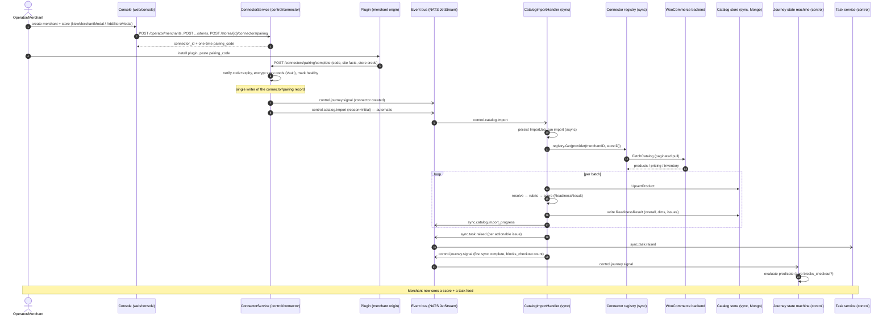
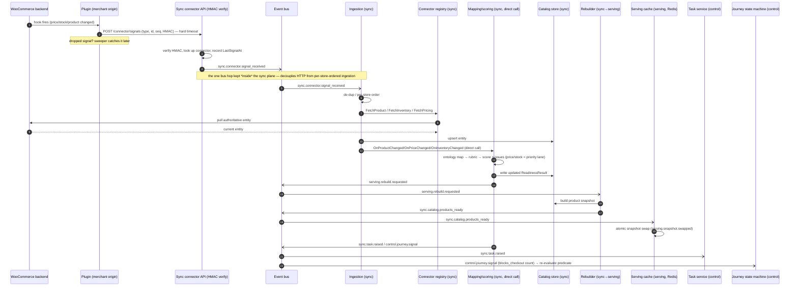
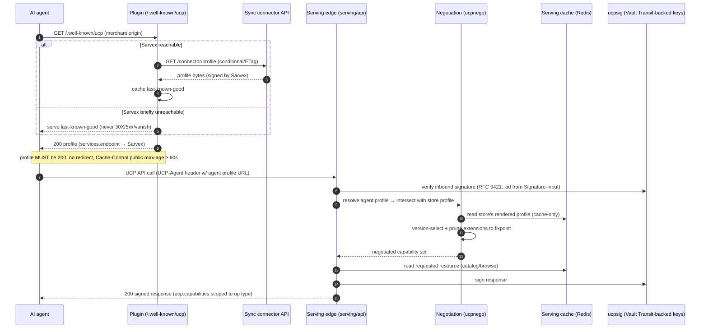
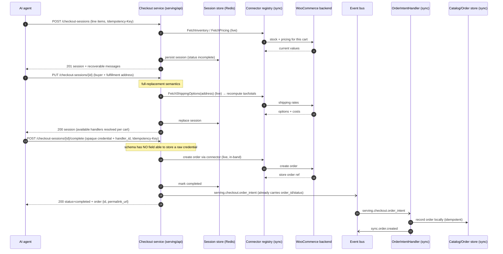
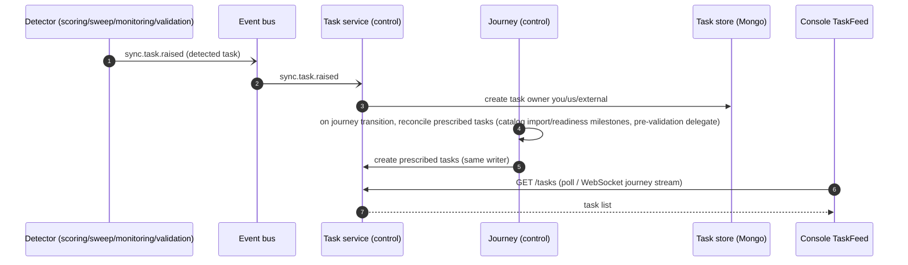
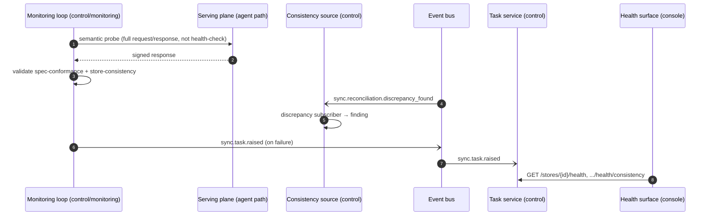
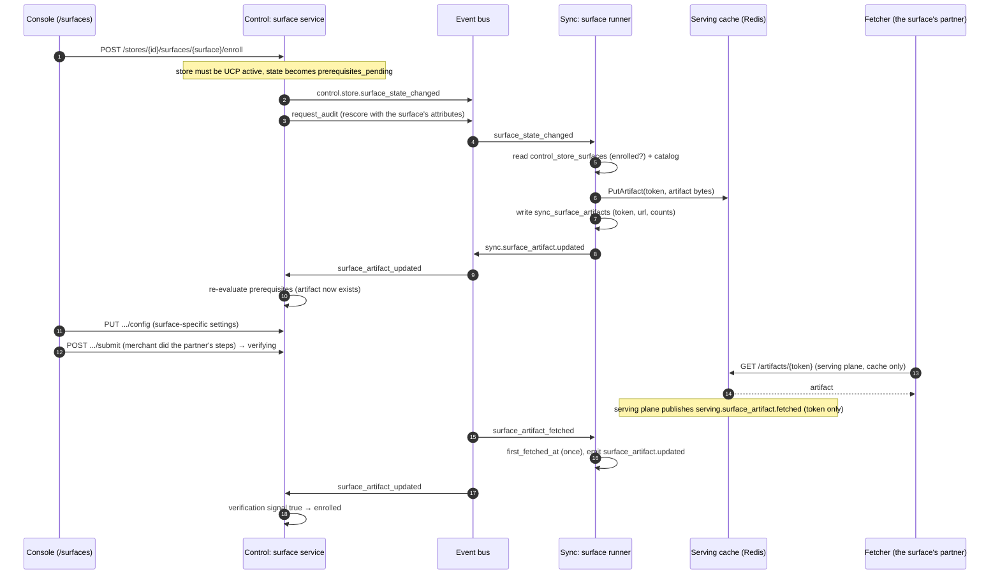
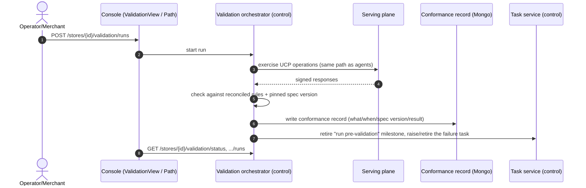

# Sarvex V1 — Sequence diagrams (who triggers what, across planes)

Companion to `sarvex-v1-architecture.md`, the control-plane OpenAPI (`sarvex-v1-control-plane.yaml`), and the sync-plane AsyncAPI (`sarvex-v1-syncing-plane-async.yaml`). Each diagram traces one flow a[...]

Participants are grouped by plane (see `sarvex-v1-architecture.md` Part A):

- **External** — AI shopping agents (UCP), the merchant's WooCommerce store + Sarvex PHP plugin, the merchant/operator humans, the Vue console.
- **Serving plane** (`internal/planes/serving`) — `/.well-known/ucp`, catalog reads, checkout sessions, negotiation, profile renderer, serving cache.
- **Sync plane** (`internal/planes/sync`) — `/connector/*` HMAC API, ingestion, mapping/scoring, catalog import, sweep, surface artifacts, order-intent, connector registry.
- **Control plane** (`internal/planes/control`) — console REST API + WebSocket, pairing lifecycle, the journey concierge funnel + the store's own `activation` lifecycle (the actual "alive" truth), t[...]

**Conventions:** solid arrow = request/call; dashed arrow = return/async event. Bus topic names are the literal constants from `internal/pkg/ucp/event_types.go` / `command_types.go` — that file is t[...]

> **Per-store note:** every flow is scoped to one **store** (`domain.StoreID`). A merchant may own several stores (`merchant → store → connector`); each has its own connector, profile, serving-cac[...]

---

## 1. Onboarding → first readiness score

**Trigger:** an operator (or, in Phase B, the merchant) creates a merchant + store in the console and pairs the plugin. **Reaction chain:** pairing completes → the control plane automatically fires [...]

A console "resync" button (`POST /connectors/{id}/resync`) publishes `control.connector.resync_requested` → `control.catalog.import` (reason=resync), handled by the identical `CatalogImportHandler` [...]

**Teammate invites (not diagrammed — single control-plane hop):** once an owner exists, `Console → POST /account/members {email} → AccountService.InviteTeamMember` (checks the seat cap from bill[...]

---

## 2. Catalog change heartbeat (steady state)

**Trigger:** something changes in the merchant's store (price, stock, product). **Reaction chain:** thin signal → fat pull → re-score → cache rebuild + tasks + journey re-eval. Price/stock take [...]

**Reconciliation sweep (safety net, scheduled):** `SweepHandler` periodically full-pulls via the connector registry, diffs against the catalog store, and emits `sync.reconciliation.discrepancy_found` [...]

---

## 3. Profile discovery & per-request negotiation

**Trigger:** an agent discovers the merchant and calls a UCP operation. **Reaction chain:** agent fetches the profile from the merchant origin (served by the plugin from Sarvex's bytes), then calls Sa[...] 

Discovery/negotiation failures follow the spec's two-bucket model: transport errors (profile unreachable/malformed) are 4xx; a valid-but-empty intersection is a `200` business outcome with a `continue[...] 

---

## 4. Checkout session (the money path)

**Trigger:** an agent starts a purchase. **Reaction chain:** create/update/complete against the serving plane; unlike discovery, checkout calls the **merchant backend live** (via the sync connector) f[...]

---

## 5. Task raising & notification

**Trigger:** any component detects something actionable, or a journey transition prescribes a required step. **Reaction chain:** `sync.task.raised` → task service creates the task → console shows [...]

Both detected and prescribed tasks live on the **one spine** (`control/task`), differ only by owner, and are created by the single task-service writer.

---

## 6. Monitoring loop (post go-live)

**Trigger:** scheduled. **Reaction chain:** semantic probes hit the serving plane *as an agent would*; consistency runs on change; findings route to tasks/health.

The probe path being identical to the agent path is the point — it can't pass while real traffic fails.

---

## 7. Agent-surface enrollment and artifacts

Who triggers what for a surface that generates an artifact. The flow names no
surface: `<surface>` stands for any registered surface whose sync half generates
an artifact (the bundled `direct_agent` surface generates none, so this flow is
what a new surface plugs into — see `docs/HOWTO-add-surface.md`).

Catalog changes re-run the generator (debounced); an hourly safety net backs up
missed events; withdrawal unpublishes the artifact and deletes its record.

---

## 8. Validation & conformance

**Trigger:** the journey's `ready` stage delegates a "run pre-validation" milestone task (`journey/stage_work.go`), or an operator/merchant triggers a run directly. **Reaction chain:** the validation [...]

The conformance record is the audit trail for "this store is compliant as of date X," pinned to the definitions-catalogue / spec version in force.

> **How a store actually reaches `live`:** not through this flow. `internal/planes/control/activation` independently derives the store's real lifecycle (`draft → connector_linked → profile_publish[...]

*Reading these before implementing any cross-plane flow: the bus is the only cross-plane channel, the serving plane's only inbound dependency is the atomic snapshot swap, and the one-writer-per-store [...]
